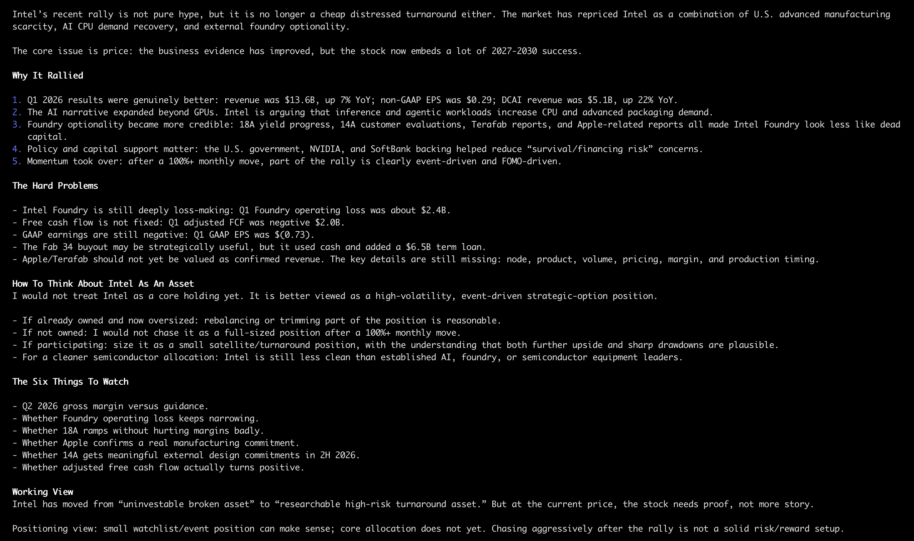

# AIFi

[](./README.md)
[](./README.zh-CN.md)
[](https://linux.do/)

AIFi is an agent-first investment research workspace. It uses small, reusable AI
skills to collect filings, earnings, news, market signals, competitors, and risk
evidence, then saves the work under `research/` so future analysis can reuse it.

It is for research and decision support, not autonomous trading or financial
advice.

## Local app preview

The local Web and Electron apps share one React interface. The first version
uses demo data; model calls, broker connections, and background agents come later.

Stocks opens with a stock list and six research tabs. Chart/financial examples
are marked as samples; holdings, trades, ratings, and news have empty structures
until data is connected. Existing chats remain available inside Chat.

Requires Node.js 24+ and pnpm 10.13.1.

```sh
pnpm install
pnpm dev             # Web: http://127.0.0.1:5173
pnpm dev:desktop     # Electron + local Web server; use instead of pnpm dev
```

```sh
pnpm build
pnpm desktop         # Run the built desktop app
make ci
```

The first desktop launch downloads the Electron runtime. See
[frontend development](docs/FRONTEND.md), [architecture](docs/ARCHITECTURE.md),
and the shared [design system](DESIGN.md).

## Usage

```sh
codex "Analyze why Intel has rallied recently and how to think about it as a portfolio position"
```

```sh
codex "Update my Intel research with the latest earnings, filings, news, and market signals"
```

```sh
codex "Compare Intel with AMD, Nvidia, and TSMC, then summarize the bull, base, and bear cases"
```

## Preview


### Research artifact example


