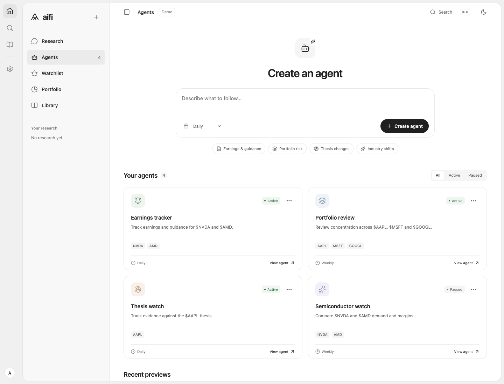
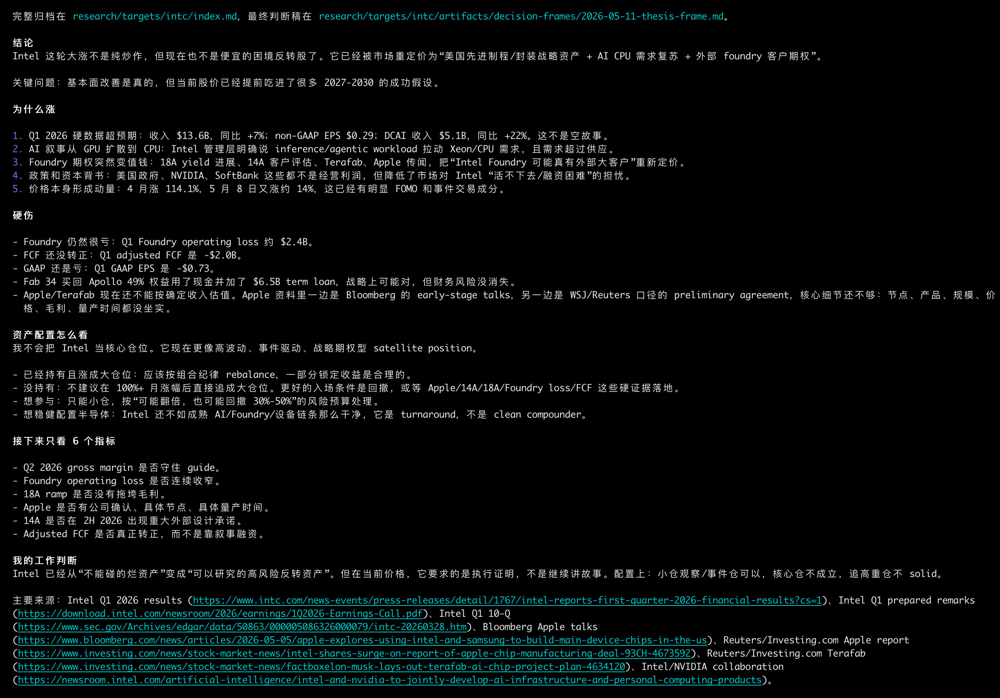

# AIFi

[](./README.md)
[](./README.zh-CN.md)

AIFi 是一个 agent-first 的投资研究工作区。它用一组可复用的 AI skills
收集公告、财报、新闻、市场信号、竞品和风险证据，并把研究材料沉淀到
`research/`，方便后续持续复用。

它用于研究和决策辅助，不做自动交易，也不是财务建议。

## 本地应用预览

Web 和 Electron 复用同一套 React 界面。股票目录读取真实的本地缓存，行情与研究数据暂用样例；模型调用、
券商接入和后台 Agent 将在后续实现。

默认打开 Stocks，内侧栏支持真实目录搜索和分页，个股页包含六个研究标签。行情和财务示例
标注为样例；持仓、交易、评级和新闻暂时显示空状态。原有会话仍可在 Chat 中打开。

需要 Node.js 24+、Go 1.26.1+、pnpm 10.13.1。

```sh
pnpm install
pnpm dev             # Web：http://127.0.0.1:5173
pnpm dev:desktop     # Electron + 本地 Web 服务，与 pnpm dev 二选一
```

```sh
pnpm build
pnpm desktop         # 启动构建后的桌面应用
make ci
```

首次启动桌面端会下载 Electron 运行时。目录边界见
[架构文档](docs/ARCHITECTURE.md)，开发命令见
[前端指南](docs/FRONTEND.md)，界面规范见 [DESIGN.md](DESIGN.md)。

## 股票目录采集

首个真实采集器已接入 Nasdaq Trader 官方证券目录，写入本地 SQLite。
需要 Go 1.26.1+，无需 API Key。应用启动时会启动 Go 服务，设置中可管理数据源、同步周期和本机凭据。
行情和财务页面仍使用样例。

```sh
make check-go
./bin/aifi data directory sync
./bin/aifi data directory list --query AAPL
```

详见 [CLI 命令与存储](apps/cli/README.md)。

## 用法

```sh
codex "分析 Intel 最近为什么大涨，以及应该如何看待它在组合里的位置"
```

```sh
codex "更新我的 Intel 研究，补充最新财报、公告、新闻和市场信号"
```

```sh
codex "对比 Intel、AMD、Nvidia 和 TSMC，并总结 bull/base/bear case"
```

## 效果预览



### 研究产物示例


