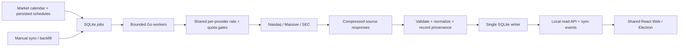

# Local US Stock Data Pipeline

Status: proposed implementation design, 2026-10-13. The user confirmed daily /
closing data first. This document specifies the first live data capability; the
current React/Electron application remains a demo until the implementation
milestones pass. No collector, scheduler, Go module, or provider key is added by
this design task.

## Decisions

- Develop against AAPL, MSFT, and NVDA; expand using the same contracts.
- Default to Massive Basic EOD prices, Nasdaq Trader directory, and SEC filings /
  entity-wide financial facts. Alpaca historical SIP is the first alternative.
- Use a local Go/Cobra service, SQLite for normalized data and durable jobs, and
  compressed raw responses on disk. No cloud, Redis, Kafka, or required Python.
- React reads a local data contract. Pages do not fetch providers or start
  scheduling loops. Research agents consume the stored data later.
- Use four initial tabs: Overview, Chart, Financials, Filings. Exclude trading,
  ratings, politician activity, full news ingestion, and AI conclusions.

Provider facts, primary links, probe results, quota limits, and upstream source
observations are in [the provider review](../references/us-stock-data-providers.md).
SEC returned 403 in this environment; Massive requires a user key. These are
validation gates, not reasons to promise a working live backend today.

## Universe And Coverage

Target **US exchange-listed common stocks and ADRs**, including US-listed foreign
issuers. ETFs, preferreds, warrants, units, OTC, options, and mutual funds are
separate future universes. A provider's market-wide OHLC response contains more
than this product universe; filter after ingestion without dropping raw evidence.

Directory membership, company identity, price coverage, and filing coverage are
independent. Store unclassified instruments, unsupported financial concepts,
non-SEC entities, symbol changes, delistings, and no-trade sessions explicitly.
Do not equate `ETF=N` with common stock. Enrich type/CIK from provider reference
metadata and mark unresolved type as `unknown`, outside the default stock list.
Use a stable instrument ID and dated provider-symbol aliases. One CIK can have
multiple share classes; ticker text alone is not the permanent identity.

Begin with the three targets, then 50, then the full directory. The daily market
batch can already collect all symbols; expensive company/statement enrichment
is prioritized for targets/watchlists and grows separately. Keep delisted records
and historical universe snapshots; a current-only list is insufficient for
historical research or backtesting.

## Datasets

| Dataset | Fields / scope | Initial refresh |
| --- | --- | --- |
| Instruments | ID, symbol aliases, name, MIC exchange, currency, type, listing state, CIK, first/last seen | Daily directory; paginated reference reconciliation. |
| Daily bars | Trading date, raw/split-adjusted OHLCV, optional VWAP, provider/feed, adjustment basis, source timestamp | Last completed market session; incremental gap repair. |
| Company profile | Legal name, CIK, exchange/tickers, SEC SIC, fiscal year end | Initial seed; changed submissions; weekly refresh. |
| Filings | Accession, form, report period, filing/acceptance timestamps, primary document, amendment, URL | Target submissions daily; all-universe daily index later. |
| Financial facts | Taxonomy/tag, unit, instant/duration period, value, accession, fiscal year/period, filed time | After a new relevant filing; weekly repair. |
| Selected metrics | Revenue, income, cash, assets/equity, operating cash flow, capex, diluted EPS where supported | Versioned deterministic mappings over validated facts. |
| Corporate actions | Split/dividend events and affected series | Daily delta; schedule history corrections on changes. |

Initial normalized financial coverage is selected rows, not an assertion that
Company Facts reconstructs every line of every statement. Standard entity-wide
facts can omit custom concepts/segments. IFRS/foreign issuer mappings may remain
unsupported; the listing and price data can still exist. Request older submissions
pages only when requested history requires them.

A date-only filing date and an acceptance instant are distinct. Store both.
Preserve original decimals/units and source semantics. Prefer decimal strings
for financial amounts; do not use formatted UI text as storage.

## Local Boundaries

```text
apps/cli/                  Go module and Cobra commands (planned)
  cmd/aifi/                main
  internal/config/         credentials and limits
  internal/provider/       massive, sec, nasdaq; later alpaca
  internal/normalize/      instrument aliases, bars, XBRL mappings
  internal/store/          SQLite migrations and serialized writes
  internal/jobs/           queue, claims, retries, schedules, leases
  internal/calendar/       market sessions, holidays, early closes
  internal/httpapi/        local authenticated API and events
  internal/service/        application orchestration
packages/core/             TS DTOs and domain-facing read contracts
packages/platform/         Web transport / typed desktop adaptation
packages/ui/               stock page and components
apps/desktop/              child-process lifecycle and restricted bridge
```

Commands (planned): `aifi doctor`, `aifi data sync --symbols AAPL,MSFT,NVDA`,
`aifi data backfill --from ... --to ...`, `aifi data status`, `aifi serve`.
Provider selection is configurable by dataset; avoid one enormous provider
interface that implies every vendor supports every feature.



Store data in a user-data directory outside the Git checkout. SQLite uses [WAL](https://www.sqlite.org/wal.html),
foreign keys, migrations, short transactions, and a single writer; network calls
never occur inside a write transaction. Large source payloads are streamed to a
temporary file, hashed, bounded, then atomically renamed. The DB transaction
links the blob and normalized records; orphan blobs are safe to garbage collect.
Do not store provider keys in raw metadata, request URLs, localStorage, or logs.

## Durable Scheduling

Goroutines provide concurrent workers; SQLite provides restart-safe scheduling.
One job per stock and a ticker loop alone would lose work on sleep/crash and
waste the grouped-daily capability.

| Job family | Unit | Schedule / key |
| --- | --- | --- |
| universe sync | Directory snapshot + bounded reference pagination | Daily, versioned snapshot ID. |
| market EOD | One trading date per feed/adjustment basis | After session + provider availability lag. |
| history seed | Three ticker ranges; later market-date batches | Manual/low priority, bounded date range. |
| filings sync | CIK or daily index date | Target CIK daily; all-market index later. |
| facts sync | CIK + newly seen accession/normalizer version | Trigger after relevant filing; periodic repair. |
| revision repair | Provider/date window or affected instrument | Recent sessions and corporate-action events. |

- A scheduler wakes to inspect persisted due work, not to assume each timer tick
  ran on time. Compute due sessions in `America/New_York`; timestamps stay UTC.
  Follow the exchange calendar including DST, holidays, and early closes; the
  [market-holiday endpoint](https://massive.com/docs/rest/stocks/market-operations/market-holidays)
  can supply future exceptions, with a versioned historical calendar for backfill.
- Use close + configurable publication lag as the first attempt, not a fixed
  UTC cron or a guaranteed vendor availability time. Free EOD availability must
  be measured with the user's key. Missing/incomplete current data waits until
  the provider publishes it; do not fabricate a zero bar or mark a whole-market
  snapshot complete merely because HTTP returned 200.
- Resume after laptop wake by comparing committed session watermarks. Bound
  catch-up per cycle and requeue older gaps; prioritize recent/manual target
  jobs so a two-year backfill cannot starve current data.
- Atomically claim due jobs with a lease and owner; prevent two local processes
  running the same service/store. Expired leases are reclaimable. A bounded
  channel limits workers, with provider limits shared across retries and jobs.
- First defaults: four network workers, one Massive lane at four requests/minute
  without bursts, SEC at two requests/second globally in the local service, and
  a separate bounded writer. Worker count never overrides vendor quota.
- Job states: pending, running, retry_wait, succeeded, blocked, failed, cancelled.
  A unique logical key coalesces duplicate sync requests; completed jobs can be
  deliberately requeued for revisions. Do not make success permanently block
  later corrections.
- Retry transient timeout/5xx/429 with jitter and Retry-After, at most five
  attempts per run. Persist next-attempt times; never sleep a worker for hours.
  Daily-quota exhaustion waits for the provider's documented reset. Auth/403 /
  permission failures block that provider job and request configuration repair.
- On shutdown, cancel contexts, stop claiming, finish/rollback short writes, and
  release unfinished leases. Work runs while the service is awake; an always-on
  OS service is a later explicit opt-in, not implied by a background goroutine.

Use independent completeness records for raw, validated, normalized, and dataset
coverage. Grouped responses may legitimately omit no-trade instruments; track
missing/unmapped symbols and compare coverage against the previous session.
A successful file fetch alone does not prove complete common-stock coverage.

## Quota And Scale Calculations

These are planning estimates, not measured provider throughput:

- One grouped-daily call can update the market's EOD bars. Raw and split-adjusted
  series need separate calls; read-only UI requests spend no market-data quota.
- A two-year history is roughly 504 trading dates: one basis at four calls/minute
  is about 126 minutes before parsing, retries, and gaps; two bases about 252
  minutes. Prefer three per-symbol seed calls first and one-year/default backfill,
  then progressively import dates. Respect the account's actual retention window.
- With 13,259 non-test directory rows observed in this probe, reference pages
  of 1,000 imply roughly 14 calls if the provider universe is similar, not an
  exact cross-provider count. At four/minute that is about 3.5 minutes.
- By contrast, fetching 5,000 symbols separately costs about 20.8 hours at
  four/minute. At Twelve's 800/day it takes over six days for even one per-symbol
  dataset; Alpha Vantage's ordinary 25/day takes 200 days. Batch shape matters
  more than spawning additional goroutines.
- Financial enrichment remains a separate budget: use filing-triggered work and
  CIK deduplication. Later SEC bulk seeding/daily indexes reduce request overhead,
  but need disk/memory sizing before deployment.

## Storage And Read Contract

Planned tables: instruments, instrument_aliases, universe_memberships, bars_daily,
corporate_actions, company_profiles, filings, financial_facts, derived_metrics,
source_objects, dataset_status, jobs, job_attempts, schedules, schema_migrations.

Logical bar key: instrument + date + provider + feed + adjustment basis. Facts
retain concept + unit + context/period + accession/version. Filings use CIK +
accession. Updates preserve prior source hashes/versions so revised data remains
traceable. Only advance watermarks in the commit that persists validated rows.

Every read envelope carries `data`, `source`, `asOf`, `fetchedAt`, `quality`, and
`sync`. Quality distinguishes present, missing, unsupported, stale, partial, and
error. Staleness is measured against expected sessions/filing refresh, not wall
clock alone over a weekend. `sync` never reports success when its worker failed.

Planned local API:

```text
GET  /api/v1/stocks?query=...&cursor=...
GET  /api/v1/stocks/{id}/overview
GET  /api/v1/stocks/{id}/bars?from=...&to=...&basis=split_adjusted
GET  /api/v1/stocks/{id}/financials?period=annual&statement=income
GET  /api/v1/stocks/{id}/filings?cursor=...
POST /api/v1/sync                 # coalesced async job, returns 202 + job ID
GET  /api/v1/jobs/{id}
GET  /api/v1/events               # SSE; polling fallback
```

UI reads cached data immediately and optionally queues stale/missing supported
data. Opening a tab never starts an unbounded whole-universe crawl. Sources are
links to safe public documents; error detail and provider credentials stay in
local diagnostics. Manual Refresh means queue a sync, not claim completion.

## Financial Correctness

- Keep unadjusted and split-adjusted series separate. The UI close/change uses
  a consistent basis; chart defaults to split-adjusted and names that basis.
  Split-adjusted is not dividend-adjusted or total return. Corporate actions can
  revise old adjusted bars, so invalidate affected ranges and recompute metrics.
- Missing sessions are not zero prices. Preserve suspended/delisted/no-trade
  outcomes and only calculate ranges/averages over validated coverage.
- SEC duration facts can be quarterly, YTD, or annual even with the same tag.
  Do not sum four YTD values into TTM. Derive quarter differences only from
  compatible same-fiscal-year contexts; record the derivation and dependencies.
- Deduplicate restatements by accession/context without erasing original filings.
  A latest view can use later amendments, while a point-in-time view must filter
  by actual availability/acceptance time. Keep report-period and filing dates.
- Revenue/earnings/FCF initially show fiscal year or quarter labels. Unsupported
  tags show missing. Free cash flow is explicitly derived from compatible OCF
  minus capex, with its mapping version and source references.
- Do not imply a current market cap from stale SEC share counts, or calculate
  P/E with mixed adjusted price/EPS units. Those fields can wait for a suitable
  normalized source or a documented derivation. SEC SIC is not a GICS sector.

## Web / Electron / Security

Web production should be served by the local service under one loopback origin;
development uses a narrowly configured Vite proxy. Electron owns/reuses the
local service and exposes typed dataset reads/sync requests through a restricted
bridge. Provider secrets stay in the host; preserve renderer sandbox/no Node.
No hosted backend, broker OAuth, trading permissions, or model account is needed.

Before transport implementation: bind loopback, validate Host and Origin, reject
cross-site mutations/DNS rebinding, establish a per-run authenticated local
session/nonce, bound requests, and restrict methods/routes. Never use permissive
CORS as the SEC workaround. Extend the current production CSP only for the exact
local transport if needed; do not add provider domains to the renderer.

Configuration names are reserved, not implemented: `MASSIVE_API_KEY`,
`SEC_USER_AGENT`, `AIFI_DATA_DIR`; optional Alpaca key/secret. Supply credentials
outside Git and renderer bundles. Public filing links in Electron need a narrow
validated external-link capability when implemented; current external navigation
remains denied. Read-only data access does not grant order execution.

## Acceptance And Next Work

Implement in small reviewable stages using [the execution plan](../exec-plans/active/us-stock-data-foundation.md).

1. With the user's free key, prove three EOD histories and one grouped market date;
   record coverage/adjustment semantics and actual publication lag. Resolve SEC
   access using proper identification/allowed network conditions; do not bypass.
2. Persist directory, three targets, source blobs, bars, and job status locally.
3. Verify duplicate requests, rate-limit resets, 403 block, timeout/backoff, crash
   during persistence, expired leases, sleep/wake catch-up, holidays, early close,
   and a split/restatement correction using a fake clock/provider.
4. Serve cached reads and progress safely to the shared UI; show source and period
   labels, stale/partial state, unknown/missing fields, and correct date ranges.
5. Expand to 50 then whole-market daily batches and separate filings enrichment.

Open decisions before implementation: actual key permissions/publication time,
SEC network access, Go dependency versions/packaging, financial concept coverage,
local-session bootstrap, and measured full-universe storage/retention size.
