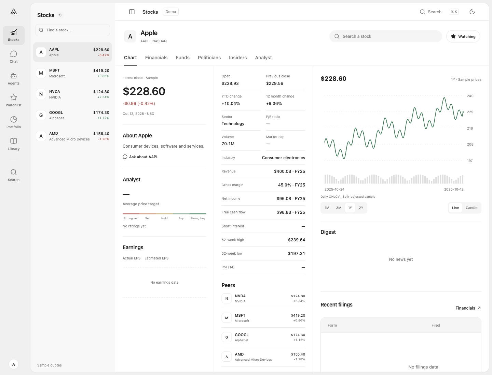

# Stock Workspace Preview

The original standalone concept graduated into the shared React Web/Electron
renderer. There is one stock-page implementation in packages/ui, not two UIs.

```sh
pnpm install
pnpm dev             # http://127.0.0.1:5173/#/stocks/AAPL?tab=chart
pnpm dev:desktop     # alternative: Electron with the same renderer
```

[preview.html](preview.html) is a compatibility entry that opens the running
local app. It needs that app to be started; it is no longer a build-free demo.
The original four tabs are replaced by Chart, Financials, Funds, Politicians,
Insiders, Analyst. Known quotes/chart/financials are marked samples; unsupported
holdings, disclosures, earnings, ratings, news, and filings have empty structures.
Watchlist and Chat use the normal local workspace storage.

Reviewed in Chrome Default through OBU at 1440×1100 and 390×844 and in actual
macOS Electron on 2026-10-13. Tables scroll internally and keyboard focus stays
neutral while Tab/Escape and tab arrow keys remain functional.

Design: [stock page](../../design-docs/stock-research-page.md),
[data pipeline](../../design-docs/us-stock-data-pipeline.md), and
[root DESIGN.md](../../../DESIGN.md).


